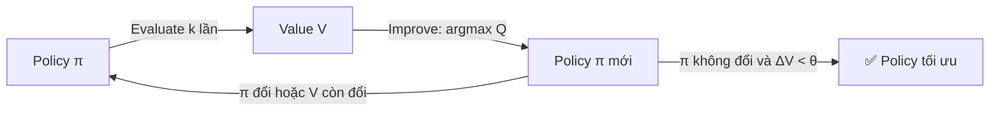

# 🧊 FrozenLake — Truncated Policy Iteration

> Tài liệu hướng dẫn dành cho **người mới (beginner / fresher)** và cho chính mình khi đọc lại sau này.
> Đọc theo thứ tự từ trên xuống. Phần nào đã biết thì bỏ qua.

---

## 📑 Mục lục

1. [Dự án này là gì?](#1-dự-án-này-là-gì)
2. [Cấu trúc thư mục](#2-cấu-trúc-thư-mục)
3. [Cài môi trường và chạy dự án](#3-cài-môi-trường-và-chạy-dự-án)
4. [Hiểu thuật toán, từ dễ đến khó](#4-hiểu-thuật-toán-từ-dễ-đến-khó)
5. [Kết quả](#5-kết-quả)
6. [Bài học rút ra](#6-bài-học-rút-ra)
7. [Chuẩn bị và push lên GitHub](#7-chuẩn-bị-và-push-lên-github)
8. [Lỗi hay gặp](#8-lỗi-hay-gặp)
9. [Học gì tiếp theo?](#9-học-gì-tiếp-theo)

---

## 1. Dự án này là gì?

Dạy một **agent** (nhân vật do máy điều khiển) tìm đường **an toàn nhất** băng qua một hồ băng trơn để tới đích, bằng thuật toán **Truncated Policy Iteration**.

```
S F F F      S = Start (xuất phát)
F H F H      F = Frozen (băng, đi được)
F F F H      H = Hole (hố, rơi vào là thua)
H F F G      G = Goal (đích, tới nơi được +1 điểm)
```

**Cái khó:** băng **trơn**. Bấm "→" thì chỉ có **1/3** khả năng đi đúng sang phải, **2/3** còn lại bị trượt sang hai hướng vuông góc. Vì vậy đường ngắn nhất chưa chắc đã là đường tốt nhất.

| Thông tin | Giá trị |
|---|---|
| Môi trường | `FrozenLake-v1` (thư viện **Gymnasium**), bản đồ 4x4, `is_slippery=True` |
| Thuật toán | Truncated Policy Iteration (thuộc nhóm Dynamic Programming) |
| Ngôn ngữ | Python 3.10+ |
| Thư viện | `gymnasium`, `numpy`, `pygame` (dùng để vẽ giao diện) |

---

## 2. Cấu trúc thư mục

```
frozenlake-truncated-policy-iteration/
├── MaSo_HoTen.ipynb       # Notebook chính: cài đặt thuật toán + thí nghiệm
├── watch_agent.py         # Xem agent chạy trong terminal (dạng chữ)
├── watch_agent_ui.py      # Xem agent chạy bằng cửa sổ đồ hoạ (pygame)
├── policy.npy             # Policy đã học, do notebook lưu ra
├── requirements.txt       # Danh sách thư viện cần cài
├── .gitignore             # Các file KHÔNG đưa lên GitHub
├── instructions.md        # File bạn đang đọc
└── README.md              # Giới thiệu ngắn, trang đầu tiên khi mở repo
```

---

## 3. Cài môi trường và chạy dự án

> Hướng dẫn cho **Windows**. Trên macOS/Linux, chỗ nào ghi `.venv\Scripts\activate` thì thay bằng `source .venv/bin/activate`.

### Bước 1: Kiểm tra Python

```powershell
python --version
```

Phải ra **Python 3.10 đến 3.12**. Nếu báo *not recognized*: tải Python ở [python.org](https://www.python.org/downloads/), khi cài nhớ **tick ô "Add python.exe to PATH"**.

### Bước 2: Lấy code về

```powershell
git clone https://github.com/QuocAnh2004/frozenlake-truncated-policy-iteration.git
cd frozenlake-truncated-policy-iteration
```

### Bước 3: Tạo môi trường ảo (venv)

```powershell
python -m venv .venv
.venv\Scripts\activate
```

> 💡 **venv là gì?** Là một "hộp" chứa thư viện riêng cho từng dự án, để thư viện của dự án này không đụng thư viện của dự án khác. Nó giống việc mỗi project Java có `pom.xml` riêng.
>
> Activate thành công thì đầu dòng lệnh sẽ có `(.venv)`.

Nếu báo lỗi *running scripts is disabled*, chạy lệnh này **một lần** rồi activate lại:

```powershell
Set-ExecutionPolicy -Scope CurrentUser RemoteSigned
```

### Bước 4: Cài thư viện

```powershell
pip install -r requirements.txt
```

### Bước 5: Chạy notebook

**Cách A: VS Code (khuyên dùng)**

1. Cài 2 extension của Microsoft: **Python** và **Jupyter**.
2. Vào **File → Open Folder**, mở **cả thư mục** dự án (đừng mở từng file lẻ).
3. Mở file `.ipynb`, bấm **Select Kernel → Python Environments → `.venv`**.
4. Bấm **Run All**.

**Cách B: Jupyter trên trình duyệt**

```powershell
jupyter notebook
```

Giữ nguyên cửa sổ terminal này. Nó đang chạy server, tắt đi là Jupyter dừng. Muốn gõ lệnh khác thì mở thêm một tab terminal mới.

**Cách C: Chạy bằng dòng lệnh, không cần IDE**

```powershell
jupyter nbconvert --to notebook --execute --inplace MaSo_HoTen.ipynb
```

Lệnh này chạy toàn bộ notebook và ghi output vào lại file. Các dòng `WARNING` hiện ra trên Windows là bình thường. Chỉ khi thấy chữ `Error` hoặc `Traceback` mới là lỗi.

### Bước 6: Xem agent chạy

Notebook có một cell `np.save("policy.npy", policy)` để lưu policy đã học. Sau khi notebook chạy xong:

```powershell
python watch_agent.py       # bản chữ trong terminal
python watch_agent_ui.py    # bản có cửa sổ đồ hoạ
```

Dòng tiêu đề hiện `[policy NGẪU NHIÊN]` nghĩa là chưa có `policy.npy`. Bạn cần chạy notebook trước.

---

## 4. Hiểu thuật toán, từ dễ đến khó

### 4.1. 🧒 Giải thích cho người hoàn toàn mới

**Bé Bin** đứng ở góc hồ băng, **hộp kẹo 🍬** nằm ở góc bên kia, trên hồ có **lỗ thủng 🕳️**. Băng trơn nên Bin hay bị trượt.

Mẹ muốn vẽ cho Bin một **tấm bản đồ: trên mỗi ô có một mũi tên**, bảo Bin đứng ở đó thì nên bước theo hướng nào. Mẹ vẽ bằng cách lặp lại 2 việc:

1. **Chấm điểm từng ô**: *"Đi theo bản đồ này thì từ ô này có bao nhiêu khả năng lấy được kẹo?"*
2. **Vẽ lại mũi tên**: *"Biết điểm rồi, từ mỗi ô nên bước về phía ô điểm cao nhất."*

Lặp đến khi vẽ lại mà mũi tên không đổi nữa. Lúc đó ta có **bản đồ tốt nhất**.

**"Truncated"** nghĩa là mẹ không chấm điểm quá kỹ. Chấm nhanh **k lần** là vẽ lại mũi tên luôn, vì đằng nào bản đồ cũng còn bị sửa tiếp.

### 4.2. Các khái niệm chính

Bài toán được mô hình hoá thành một **MDP** (Markov Decision Process, quá trình ra quyết định Markov):

| Khái niệm | Nghĩa đơn giản | Trong FrozenLake | Trong code |
|---|---|---|---|
| **State** (trạng thái) | Agent đang ở đâu | Ô số 0 → 15 | `s`, `N_STATES = 16` |
| **Action** (hành động) | Agent làm gì | 0=←, 1=↓, 2=→, 3=↑ | `a`, `N_ACTIONS = 4` |
| **Transition** (xác suất chuyển) | Làm hành động đó thì đi tới đâu, xác suất bao nhiêu | Bấm → thì 1/3 đi đúng, 2/3 trượt | `P[s][a]` |
| **Reward** (phần thưởng) | Được bao nhiêu điểm | Tới G được +1, còn lại 0 | `reward` |
| **γ (gamma)** | Phần thưởng càng xa thì càng bớt giá trị | 0.99 | `GAMMA` |
| **Policy π** | Bản đồ mũi tên: ở ô nào thì làm gì | Mảng 16 hướng | `policy[s]` |
| **Value V(s)** | Điểm của ô: đi theo π thì kỳ vọng được bao nhiêu | Bảng 16 số | `V[s]` |
| **Q(s, a)** | Điểm của việc **làm hành động a** tại ô s | 16 × 4 số | `q_from_v(V, s)` |

Cấu trúc của `P[s][a]`, lấy ví dụ đứng ở ô 14 và bấm →:

```python
P[14][2] = [
    (0.333, 14, 0, False),   # trượt xuống, bị tường chặn, đứng yên
    (0.333, 15, 1, True),    # đi đúng → tới G, +1, kết thúc
    (0.333, 10, 0, False),   # trượt lên ô 10
]
# mỗi phần tử là: (xác suất, ô_tới, reward, kết_thúc?)
```

### 4.3. Công thức (đọc sau cũng được)

Tính **Q** của một hành động = trung bình có trọng số của (phần thưởng + giá trị ô tới):

```
Q(s, a) = Σ  xác_suất × ( reward + γ × V(ô_tới) )
```

Nếu ô tới là ô kết thúc (hố hoặc đích) thì không cộng phần `γ × V(ô_tới)`.

| Bước | Công thức | Nghĩa |
|---|---|---|
| Policy Evaluation | `V(s) ← Q(s, π(s))` | Điểm của ô = điểm của hành động mà policy chọn |
| Policy Improvement | `π(s) ← argmax_a Q(s, a)` | Chọn hành động có điểm cao nhất |

### 4.4. Policy Iteration vs Truncated vs Value Iteration



| Thuật toán | Evaluate bao nhiêu lần trước khi Improve | Ưu điểm | Nhược điểm |
|---|---|---|---|
| **Policy Iteration** | Đến khi V hội tụ hẳn | Ít vòng lặp lớn | Mỗi vòng rất tốn |
| **Truncated Policy Iteration** | **k lần** | Cân bằng giữa hai bên | Phải chọn k |
| **Value Iteration** | 1 lần | Mỗi vòng rất rẻ | Nhiều vòng lặp |

👉 **Ý chính:** cả 3 đều cho ra **cùng một policy tối ưu**. Value Iteration và Policy Iteration chỉ là hai trường hợp đặc biệt của Truncated (k = 1 và k = ∞). Ý tưởng chung "đánh giá một phần → cải thiện → lặp lại" có tên là **Generalized Policy Iteration (GPI)**.

### 4.5. Pseudocode

```
V = [0, 0, ..., 0]
π = [←, ←, ..., ←]

lặp:
    # 1. Truncated Evaluation
    lặp k lần:
        với mỗi ô s:  V[s] = Q(s, π[s])

    # 2. Improvement
    với mỗi ô s:  π_mới[s] = argmax_a Q(s, a)

    # 3. Điều kiện dừng
    nếu π_mới == π  VÀ  max|V_mới − V_cũ| < θ:  dừng
    π = π_mới
```

> ⚠️ **Bẫy điều kiện dừng:** nếu chỉ kiểm tra `ΔV < θ` thì thuật toán dừng ngay vòng đầu. Lý do: policy ban đầu toàn "←" không bao giờ tới G, nên V = 0 và ΔV = 0. Phải kiểm tra **cả policy lẫn V**.

---

## 5. Kết quả

**Policy học được** (bản đồ 4x4, băng trơn, γ = 0.99):

```
← ↑ ↑ ↑
← H ← H
↑ ↓ ← H
H → ↓ G
```

| Chỉ số | Giá trị |
|---|---|
| Tỉ lệ thắng của policy học được | **khoảng 75%** (đo trên 1000 ván) |
| Tỉ lệ thắng của policy ngẫu nhiên | khoảng 0–2% |

**Ảnh hưởng của k:**

| k | Số vòng lặp lớn | Tổng số lần quét (sweep) | Tỉ lệ thắng |
|---|---|---|---|
| 1 | 325 | 325 | 0.752 |
| 3 | 118 | 354 | 0.752 |
| 5 | 75 | 375 | 0.752 |
| 10 | 41 | 410 | 0.752 |
| 50 | 14 | 700 | 0.752 |

*Kết quả có thể chênh lệch một chút tùy máy và seed.*

---

## 6. Bài học rút ra

1. **Mô hình hoá bài toán:** mọi bài toán ra quyết định có thể tách thành *state, action, transition, reward*. Đây cũng là khung tư duy khi thiết kế **AI Agent** (agent nhận trạng thái, chọn tool để gọi, được đánh giá là tốt hay chưa).
2. **Evaluate rồi Improve:** muốn làm tốt hơn thì trước hết phải biết cách hiện tại tốt tới đâu.
3. **Không cần hoàn hảo từng bước:** đánh giá vừa đủ (k nhỏ) rồi cải thiện ngay vẫn tới được kết quả tối ưu. k càng lớn thì càng ít vòng lặp lớn, nhưng tổng công sức chưa chắc ít hơn.
4. **Agent tự nghĩ ra chiến thuật:** ở ô xuất phát, policy chọn **←**, tức là cố tình đâm vào tường. Lý do là nếu bị trượt thì chỉ trượt **xuống** (an toàn), không trượt vào hố. Không ai dạy agent mẹo này.
5. **Môi trường ngẫu nhiên thì không thắng 100%:** policy tối ưu chỉ thắng khoảng 75%, vì băng trơn là yếu tố agent không kiểm soát được.
6. **Giới hạn của phương pháp:** thuật toán này cần **biết trước** `P` (bản đồ và xác suất trượt). Ngoài đời thường không có, nên mới cần các thuật toán học từ trải nghiệm như **Q-learning**.

---

## 7. Chuẩn bị và push lên GitHub

### 7.1. Checklist trước khi push

- [ ] Notebook đã chạy sạch từ đầu: **Restart → Run All**, không có lỗi
- [ ] Đã điền phần **Nhận xét** trong notebook
- [ ] Đã tạo file `requirements.txt`
- [ ] Đã tạo file `.gitignore`
- [ ] Đã viết `README.md`
- [ ] ⚠️ **Cân nhắc thông tin cá nhân:** notebook có MSSV và họ tên. Repo để chế độ *Public* thì ai cũng xem được. Bạn có thể bỏ MSSV đi, hoặc để repo ở chế độ *Private*.

### 7.2. Tạo `requirements.txt`

Tạo file `requirements.txt` với nội dung:

```
gymnasium[toy-text]
numpy
jupyter
ipykernel
```

> Vì sao không dùng `pip freeze > requirements.txt`? Lệnh đó liệt kê **cả trăm** thư viện phụ, kèm version cố định, nên dễ lỗi trên máy khác. Với dự án học tập, chỉ ghi những thư viện mình trực tiếp dùng là gọn hơn.

### 7.3. Tạo `.gitignore`

Tạo file `.gitignore` với nội dung:

```
# Môi trường ảo: nặng hàng trăm MB, người khác tự tạo lại bằng requirements.txt
.venv/

# File tạm của Python và Jupyter
__pycache__/
.ipynb_checkpoints/

# Cài đặt riêng của IDE
.vscode/
```

> `policy.npy` **có thể** đưa lên GitHub. File rất nhẹ, và người xem có thể chạy `watch_agent_ui.py` ngay mà không cần chạy notebook trước.

### 7.4. Viết `README.md` ngắn gọn

README là **trang đầu tiên** người xem (kể cả nhà tuyển dụng) nhìn thấy. Nên có:

```markdown
# FrozenLake — Truncated Policy Iteration

Agent học đường đi an toàn trên hồ băng trơn bằng Truncated Policy Iteration.
Tỉ lệ thắng ~75% (policy ngẫu nhiên ~1%).


## Chạy nhanh
pip install -r requirements.txt
python watch_agent_ui.py

## Tìm hiểu thêm
Xem chi tiết trong [instructions.md](instructions.md).
```

> 💡 Mẹo: quay màn hình cửa sổ `watch_agent_ui.py` thành file `demo.gif` (dùng ScreenToGif, miễn phí) rồi đặt vào README. Có hình động thì người xem dễ bị thu hút hơn hẳn.

### 7.5. Các bước push

**Bước 1: Tạo repo trên GitHub**

Vào [github.com/new](https://github.com/new) rồi điền:
- **Repository name:** `frozenlake-truncated-policy-iteration` (theo kiểu kebab-case: chữ thường, nối bằng dấu gạch ngang)
- **Public** hoặc **Private**
- **KHÔNG** tick *Add a README* hay *Add .gitignore*, vì mình đã có sẵn ở máy. Tick vào sẽ gây xung đột khi push.

**Bước 2: Đẩy code lên**

Trong terminal, tại thư mục dự án:

```powershell
git init
git add .
git status
git commit -m "feat: implement truncated policy iteration on FrozenLake"
git branch -M main
git remote add origin https://github.com/QuocAnh2004/frozenlake-truncated-policy-iteration.git
git push -u origin main
```

| Lệnh | Ý nghĩa |
|---|---|
| `git init` | Biến thư mục thành một git repo (chỉ chạy **1 lần**) |
| `git add .` | Đưa mọi file (trừ những file trong `.gitignore`) vào danh sách chuẩn bị commit |
| `git status` | **Kiểm tra trước khi commit**: đảm bảo **không có** `.venv/` trong danh sách |
| `git commit -m "..."` | Lưu lại một mốc thay đổi, kèm lời mô tả |
| `git branch -M main` | Đổi tên nhánh thành `main`, tên chuẩn hiện nay |
| `git remote add origin <url>` | Nối repo ở máy với repo trên GitHub (chỉ chạy **1 lần**) |
| `git push -u origin main` | Đẩy code lên. `-u` để lần sau chỉ cần gõ `git push` |

**Lần sau, khi có sửa đổi:**

```powershell
git add .
git commit -m "docs: update instructions"
git push
```

### 7.6. Quy tắc viết commit message (Conventional Commits)

| Tiền tố | Dùng khi | Ví dụ |
|---|---|---|
| `feat:` | Thêm tính năng | `feat: add pygame viewer` |
| `fix:` | Sửa lỗi | `fix: stop condition checks policy stability` |
| `docs:` | Sửa tài liệu | `docs: add k comparison table` |
| `refactor:` | Sắp xếp lại code, không đổi chức năng | `refactor: extract run_episode function` |
| `chore:` | Việc lặt vặt (config, gitignore...) | `chore: add .gitignore` |

---

## 8. Lỗi hay gặp

| Hiện tượng | Nguyên nhân và cách sửa |
|---|---|
| `'python' is not recognized` | Python chưa có trong PATH. Cài lại và tick **Add to PATH** |
| `running scripts is disabled` | Chạy `Set-ExecutionPolicy -Scope CurrentUser RemoteSigned` |
| `ModuleNotFoundError: gymnasium` | Chưa activate venv, hoặc VS Code đang chọn sai kernel |
| Gõ lệnh vào terminal không được | Terminal đang chạy Jupyter server. Mở thêm tab mới |
| Chạy xong hiện nhiều `WARNING` | Bình thường trên Windows. Chỉ `Error` hoặc `Traceback` mới là lỗi |
| Hội tụ sau 1 vòng, win rate 0 | Điều kiện dừng chỉ kiểm tra ΔV, thiếu phần so sánh policy |
| Vòng lặp chạy mãi không dừng | Quên gán `policy, V = new_policy, V_new` ở cuối vòng |
| Viewer hiện `[policy NGẪU NHIÊN]` | Chưa có `policy.npy`, hoặc đang chạy script ở thư mục khác |
| `pygame` báo lỗi khi mở cửa sổ | Chưa cài `pip install "gymnasium[toy-text]"` |
| Cửa sổ pygame bị "Not Responding" vài giây | Bình thường, đó là lúc chương trình nghỉ giữa các ván |
| `git push` bị từ chối (rejected) | Repo trên GitHub đã có sẵn file. Lần sau tạo repo **trống** |
| Thấy `.venv/` trong `git status` | Thiếu `.gitignore`, hoặc file đặt sai tên. Sửa xong chạy `git rm -r --cached .venv` |

---

## 9. Học gì tiếp theo?

| Chủ đề | Vì sao |
|---|---|
| **Q-learning** | Agent **không** biết trước `P`, phải tự đi thử và rút kinh nghiệm. Đây là bước tiếp theo tự nhiên của bài này |
| **FrozenLake 8x8** | Bản đồ lớn hơn, xem thuật toán có còn chạy tốt không |
| **Deep Q-Network (DQN)** | Khi số state quá lớn, không lưu thành bảng được nữa, nên dùng neural network để ước lượng Q |
| **RLHF** *(ghi chú học sau)* | Cách huấn luyện LLM bằng phản hồi của con người. Có cùng gốc ý tưởng policy và reward như bài này |

---

*Batoluxi · FrozenLake Truncated Policy Iteration*
